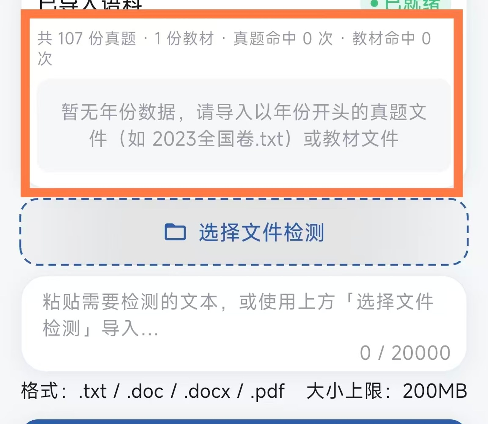
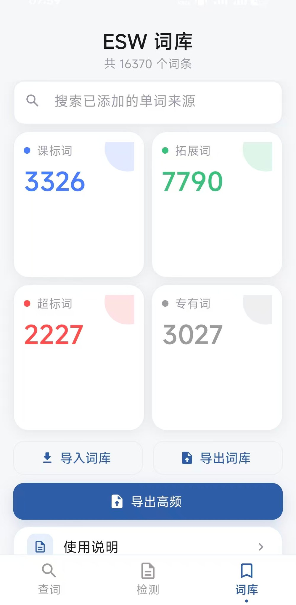

# ESW · 真题课标词

**Exam-tested Syllabus Words** — 高中英语命题研究的词汇检测与词频分析工具

[](https://github.com/beenhow/ESW/releases/latest)
[](#下载与安装)
[](https://flutter.dev)
[](LICENSE)

---

把一整套历年真题丢进去，几秒钟内看清：哪些词超纲、哪些词高频、哪些词反复出现却不在课标里。

ESW 面向**命题人与教研人员**：以 3100 课标词为基准，对真题语料做词级穿透分析，并把结论直接导出成可交付的标注文档。**完全离线、数据不出本机**，Windows 桌面版与 Android 版共用一套核心代码与同一份词库。

## 截图

| 桌面版 · 四库词库总览 | 安卓版 · 词库概览 |
|:---:|:---:|
|  |  |
| **安卓版 · 语料检测与分类** | **安卓版 · 高频词导出** |
|  |  |

## 为什么值得用

- **分类不是猜的**：五级分类引擎带明确优先级（手动超纲 > 手动拓展 > 课标 > 反向索引拓展 > 专有 > 真题），人工纠正一次即永久生效。
- **一次检索，穿越全部年份**：词频按年份自动聚合成分布卡片，点某一年即筛出该年语境，命题时的"这个词今年考没考过"一秒回答。
- **从结果直接回到原文**：上下文匹配逐词循环着色，点击关键词跳回源文件并定位，就地选中替换——改稿不用另一个窗口。
- **导出即终稿**：高频词表一键导出 docx / xlsx，七类标注样式（初中、必修、选修、拓展、超标、专有、未筛选）全部由 `lib/shared/export_word_style.dart` 单一真源驱动，双端导出的样式像素级一致。
- **语料格式宽容**：TXT / DOC / DOCX / PDF 通吃，扫描版 PDF 走 Tesseract OCR；Windows 下直接拖文件进窗口（原生 WM_DROPFILES）。
- **不联网也能跑**：词库、语料、词典全部本地化；需要多机协同时，可选坚果云 WebDAV 同步词库（版本自适应 + 按修改时间合并，不覆盖人工标注）。
- **双端同源**：`windows_app.dart` 与 `android_app.dart` 共享词库服务、导出管线与样式规范，界面按屏宽自适应，全局字号倍率兜底夹取 0.85–1.20，小屏大字号都不塌。

## 功能一览

| 模块 | 能力 |
|------|------|
| 词汇检索 | 课标词库 3100 词 + 初中专有名词 + 不规则变化词，合计 3300+ 词条；实时搜索与分类过滤 |
| 语料分析 | 导入 TXT / DOC / DOCX / PDF，自动扫描并标记词汇；支持文件夹递归导入、多选参与检测 |
| 词频统计 | 单词出现总频、年份分布卡片；功能对标 AntConc，大批量语料检索速度显著更快 |
| 词库管理 | 课标 / 拓展 / 超纲 / 专有四库分离，支持自定义拓展词、词根映射与变形反查，四宫格一屏浏览 |
| 高频词导出 | 导出 docx / xlsx 高频词表，支持七类标注与彩色高亮；导出在 isolate 中执行并显示进度浮层，不卡界面 |
| 离线词典 | 安卓版内置 340 万词条离线词典：音标、释义、柯林斯星级、词频、变形词反查 |
| 词库同步 | 可选坚果云 WebDAV 同步，示例配置见 `esw_sync_config.example.json` |
| 跨端一致 | 桌面版与安卓版共享词库数据，可通过数据备份或 WebDAV 跨平台同步 |

### 五级分类

| 分类 | 含义 |
|------|------|
| **课标词** | 命中 3100 课标词库，附带词性与中文释义 |
| **真题词** | 在导入语料中出现，但不在课标词库、且未被人工标记 |
| **拓展词** | 人工添加的变形 / 派生 / 同义词，挂靠到某个课标词 |
| **超纲词** | 语料中出现且不在课标词库，被人工判定为超纲 |
| **专有词** | 人名、地名等专有名词，不计入超纲统计 |

## 技术栈

| 层面 | 技术 |
|------|------|
| UI 框架 | Flutter（Windows + Android 双端同源） |
| 语言 | Dart + C（FFI / 原生窗口调用） |
| 文档解析 | DOCX / EPUB（archive + xml）、PDF（pdfrx） |
| OCR | Tesseract CLI（本地语言数据，离线可用） |
| 导出 | docx / xlsx 生成 + OOXML 就地标注，isolate 并行管线 |
| 同步 | WebDAV（坚果云）客户端，冲突按修改时间合并 |
| 构建 | CMake + MSVC（Windows）、Gradle（Android） |

## 下载与安装

前往 [Releases](https://github.com/beenhow/ESW/releases/latest) 下载最新版：

| 平台 | 文件 | 说明 |
|------|------|------|
| Windows 10 / 11 | `ESW*-Windows.zip` | 解压即用，保留同目录 `data/`、`tesseract/` 与 DLL |
| Android 7.0+（API 24） | `ESW*-Android.apk` | 直接安装，首次启动需授予文件读写权限 |

> 桌面版为免安装绿色包；升级时直接覆盖，用户数据保存在同目录 `esw_config.json` 中。

## 构建

```powershell
git clone https://github.com/beenhow/ESW.git
cd ESW
flutter pub get

# Windows
flutter build windows --release   # 产物：build/windows/x64/runner/Release/

# Android
flutter build apk --release       # 产物：build/app/outputs/flutter-apk/app-release.apk
```

桌面构建需 Visual Studio 2022（含「使用 C++ 的桌面开发」工作负载）与 Flutter SDK ≥ 3.9.2。

## 项目结构

```
ESW/
├── lib/
│   ├── main.dart               # 入口：主题、字号倍率兜底、平台分发
│   ├── windows_app.dart        # 桌面版主界面与业务编排
│   ├── android_app.dart        # 安卓版主界面与业务编排
│   ├── pages/                  # 检测页、查词页、词库页
│   ├── shared/                 # 双端共享：词库服务、文档抽取、导出管线、WebDAV 同步
│   ├── theme/                  # 设计令牌、玻璃主题、响应式布局、弹窗套件
│   ├── widgets/                # 通用组件（对话框、表格、提示条）
│   └── utils/                  # 平台工具（安卓文件打开等）
├── assets/                     # 内置课标词库与资源
├── android/ · windows/         # 双端平台工程
├── tesseract/                  # OCR CLI 与语言数据
├── scripts/                    # 构建与发布脚本
└── 使用说明书.md                # 完整功能手册
```

## 文档

- [使用说明书](使用说明书.md) — 界面布局、导入规范、检测与导出全流程
- [拓展词一致性比对报告](拓展词一致性比对报告.md) — 词库一致性校验记录

## 许可证

MIT
